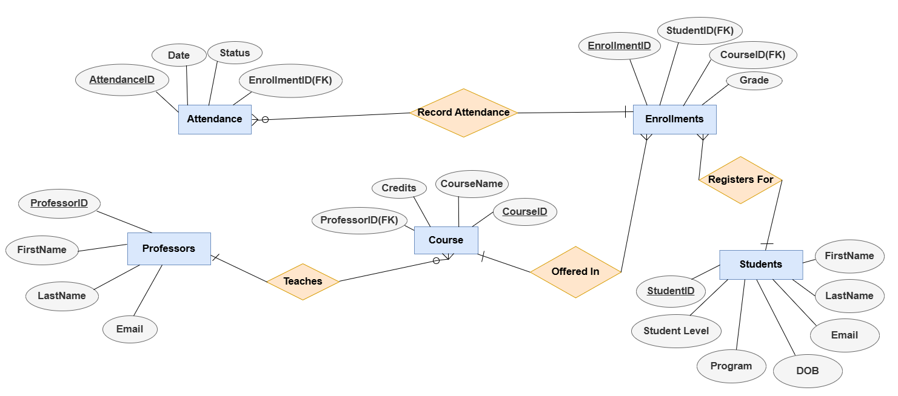
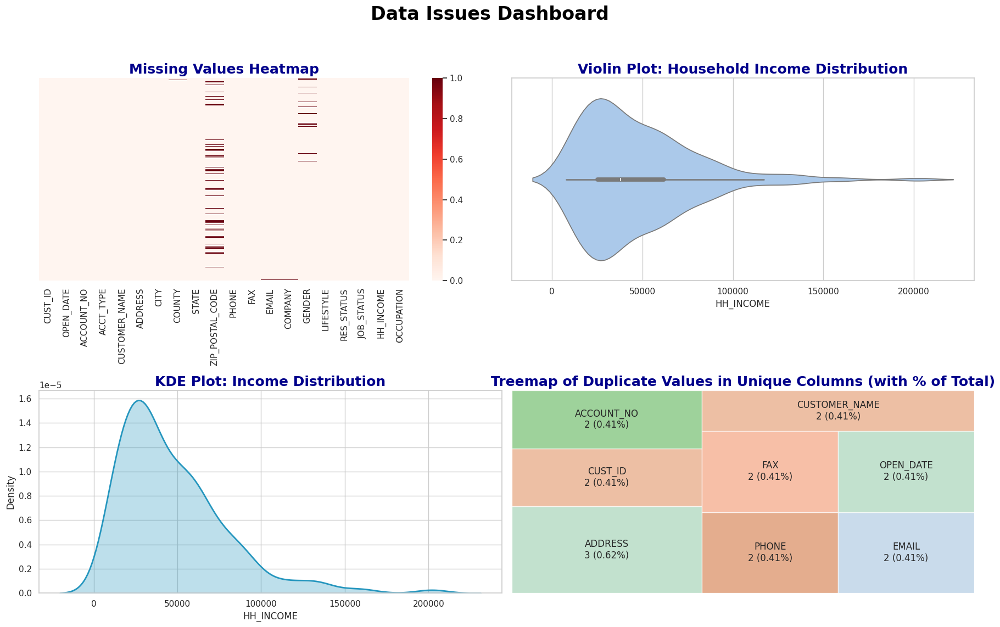

# Enterprise Database Modeling & Python Data Quality Pipeline

## SQL Database Execution & Results Video
👉 **[Click Here to Watch the SQL Query & Results Walkthrough](https://drive.google.com/file/d/17gd8LWC8T2OVL6MUI_SnVkGIopL65-UM/view?usp=sharing)**

---

## Project Overview
This project covers two core sides of data engineering and analytics:
1. **Oracle SQL Relational Database:** Designed and populated a 5-table relational database (`Inovatia Institute of Technology`) with 14 professors, 16 courses, 100 students, 270+ enrollments, and 100 attendance logs, followed by 10 analytical SQL queries.
2. **Python Data Quality & Transformation Pipeline:** Built an automated Python workflow to audit, visualize, clean, and transform a messy dataset of 483 bank customer records into an analysis-ready table.

---

## The Tech Stack
- **Database & Querying:** Oracle SQL (`CREATE TABLE`, `IDENTITY` keys, Foreign Keys, `CHECK` constraints, Window Functions `RANK()`, `PERCENTILE_CONT`, `EXISTS`)
- **Data Cleaning & Prep:** Python (Pandas, NumPy, Regular Expressions `re`, Datetime)
- **Data Visualization:** Matplotlib, Seaborn, Squarify (Treemaps)

---

## Repository Structure
- `/scripts/inovatia_database.sql` -> Complete DDL schema, `INSERT` population statements, and 10 analytical queries
- `/scripts/bank_customer_cleaning.py` -> Python scripts for issue detection, cleaning, and feature engineering
- `/visuals/er_diagram.png` -> Entity-Relationship Diagram mapping the 5 relational tables
- `/visuals/data_issues_dashboard.png` -> 2×2 visual diagnostic dashboard (Missing Value Heatmap, Violin Plot, KDE Plot, and Duplicate Treemap)

---

## Part 1: Oracle SQL Database & Analytical Queries
To streamline student, faculty, and course operations, I built a relational schema connecting five core entities: **Professors, Courses, Students, Enrollments, and Attendance**.

### Key Database & Query Highlights
- **Data Integrity:** Enforced `GENERATED BY DEFAULT AS IDENTITY` primary keys, `ON DELETE CASCADE` foreign keys, unique email constraints, and `CHECK` rules for grades (`A`–`F`), credits, and attendance status.
- **10 Analytical Business Queries:**
  * **Enrollment & Workload Tracking:** Identified courses with >5 students, professors teaching multiple courses, and total enrollment counts per professor.
  * **Subquery Filtering:** Used `EXISTS` and `NOT EXISTS` to isolate students enrolled in *Database Systems* and students with 100% attendance (zero absences).
  * **GPA & Window Function Ranking:** Converted letter grades into a 4.0 GPA scale using `CASE` statements to flag courses averaging below 2.5, rank the top 3 professors by student grades, and compute median course performance using `PERCENTILE_CONT(0.5)`.
- **Big Data Scalability Roadmap:** Outlined a transition framework to move high-volume streaming data (real-time attendance logs and video assets) onto cloud platforms like Hadoop, addressing storage limits, GDPR/FERPA privacy, encryption, and staff upskilling.

---

## Part 2: Bank Customer Data Audit & Cleaning (Python)
Before transforming the 483-row bank customer dataset (`table_BANK_CUSTOMERS.csv`), I wrote a diagnostic script and generated a 2×2 visual dashboard to uncover hidden data issues:

### Issues Detected
- **Missing Values:** Found 54 missing postal codes (`ZIP_POSTAL_CODE` - 11.18%), 16 missing `GENDER` entries (3.31%), and single missing rows in `COUNTY`, `EMAIL`, and `COMPANY`.
- **Duplicate Records:** Identified 2 exact duplicate customer profiles caused by manual double-entry.
- **Formatting & Outliers:** Found inconsistent text casing across names, addresses, and cities (over 475 rows), non-standard date strings in `OPEN_DATE`, and 18 high-income outliers (`HH_INCOME` above $117,500) spotted via Violin and KDE plots.

### Cleaning & Feature Engineering Applied
- **Imputation & Deduplication:** Filled missing categorical fields with `"Unknown"`, imputed missing postal codes with `"00000"`, and dropped duplicate records based on unique IDs (`CUST_ID`, `ACCOUNT_NO`, `EMAIL`, `PHONE`).
- **Text & Phone Standardization:** Converted names, addresses, and cities to Title Case, standardized state abbreviations to uppercase, cleaned email strings, and formatted 10-digit phone/fax numbers into `(XXX) XXX-XXXX` using regex.
- **Engineered Business Features:**
  * `INCOME_CATEGORY`: Grouped household income into *Lower Class*, *Middle Class*, and *Upper Class* tiers.
  * `STATE_REGION`: Mapped all US states into standard Census Bureau regions (*Northeast*, *Midwest*, *South*, *West*).
  * `OPEN_DATE` Breakdown: Parsed raw timestamps into clean `OPEN_YEAR`, `OPEN_MONTH`, `OPEN_DAY`, and `OPEN_MONTH_NAME` columns for time-series analysis.
  * `ACCOUNT_CATEGORY`: Calculated exact account tenure in years and used quantile splits to segment customers into *New*, *Established*, and *Loyal* tiers.
